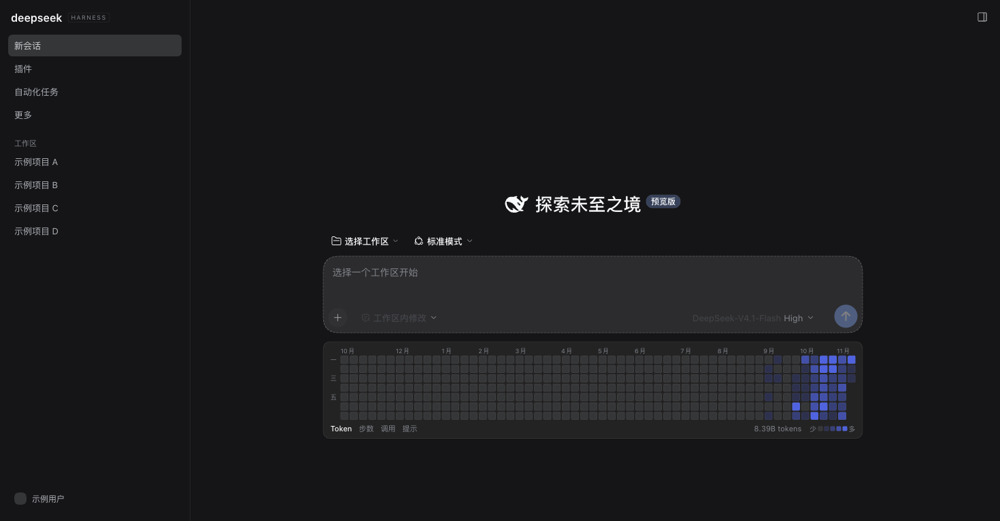
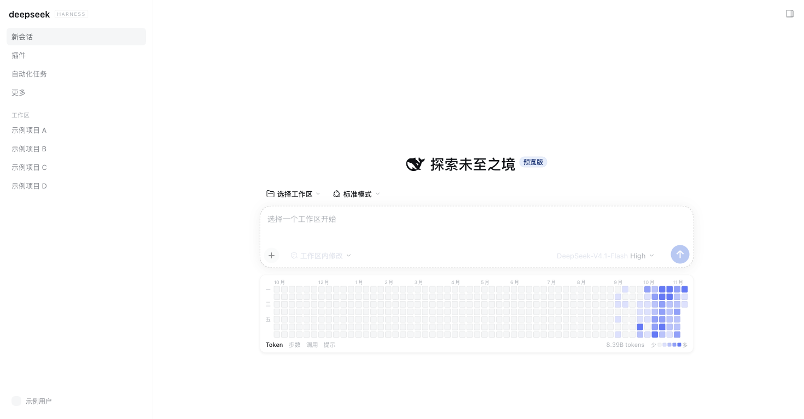

# dsh-work-heatmap

在 DSH 会话首屏（首页 / 新会话）的**输入框下方**渲染一条 **GitHub 贡献图风格的工作热力图**：每天一个小方块，颜色深浅代表当天的 **Token 消耗**（可切换为 Agent 步数 / 工具调用 / 提示次数）。

卡片本身不写标题、不设刷新按钮：宽度与输入框对齐，固定 **56 周**（约 13 个月）窗口；每次挂载到首屏自动向宿主请求一次强制刷新（宿主侧 60 秒节流）。底部只有四个口径按钮（Token / 步数 / 调用 / 提示，默认 Token）、当前口径的合计与颜色图例。





## 数据口径

默认展示 Token 消耗，可切换步数 / 工具调用 / 提示次数。

只读扫描 `$DSH_HOME/sessions/**/*.jsonl(.zstd)`，按事件时间戳（`time`）落到本地日期：

| 指标 | 事件类型 |
|---|---|
| Agent 步数 | `step/end`（完成、失败、取消、max-tokens 的步都计入） |
| 工具调用 | `tool/call` |
| 提示次数 | `user/message` + `agent/inbox/spliced` |
| Token 消耗 | `assistant/message` 的 `data.usage.totalTokens`（含输入、输出与缓存读取） |

- 单日颜色的分级按非零日期的分位数（35% / 62% / 85%），避免个别高峰日把其余日期压成同一档。
- 会话日志是「追加式多帧 zstd」（单个文件可能有 2000+ 帧），本插件按帧头结构逐帧解压，Node 自带的单次调用只会解出第一帧。
- 聚合结果按文件 `(mtime, size)` 增量缓存到 `$DSH_HOME/heatmap/cache.json`，汇总写 `$DSH_HOME/heatmap/summary.json`；全量首扫约 5~10 秒（328 个会话 / 250MB），之后命中缓存几乎零成本。

## 组成

| 文件 | 作用 |
|---|---|
| `src/index.mjs` | 宿主半侧：日志扫描、增量缓存、`GET /api/dsh-work-heatmap/summary` |
| `client.js` | 浏览器半侧：`window.__ModuleLoader__` 单文件 bundle，注册 `shell.overlay` 组件并用 portal 把卡片插到输入区容器（输入框之后）；格子用 `1fr` 轨道 + `aspect-ratio` 自适应铺满宽度 |
| `cordis.patch.yml` | 装载补丁（把插件行插进 profile） |

浏览器端挂载方式：DSH 没有在输入区内部开放插槽，唯一的非内核改法是注册 root 作用域的 `shell.overlay`，再用 `[data-composer-seat]` 与首屏标题 `[class*="_headline"]` 定位到「同时包含标题与输入框」的容器（composerStack）。挂载的宿主节点高度为 0、卡片绝对定位在宿主下方 12px，因此卡片不参与布局——输入框的垂直位置与没装插件时完全一致（宿主作为多出来的 flex 子项会多出一个 gap，用等量负 margin 抵消）。Hero 消失（进入普通对话）时节点自动卸载，因此热力图只在首页/新会话出现。

## 安装

### 从 GitHub（推荐）

```bash
dsh plugin --profile web add github:Huyuchuan/dsh-work-heatmap
```

包声明了 `dsh.bundle.patch`，安装时会自动把插件行写进 profile，无需手改 YAML；宿主重启后生效。

### 从 npm（未发布，预留）

```bash
dsh plugin --profile web add dsh-work-heatmap
```

### 手工安装

把本目录放进目标 profile 的 `node_modules`，再在该 profile 的 `cordis.patch.yml` 末尾追加：

```yaml
- insert:
    - id: dsh-work-heatmap
      name: 'dsh-work-heatmap'
```

无论哪种方式，都要重启 DSH：宿主只在启动时组合插件行，前端 bundle 才会随页面加载。

## 兼容性

- `engines.dsh: ^0.2.2-rc.1`（安装器据此拦截不兼容版本）
- 依赖首屏的 DOM 结构（`[data-composer-seat]` 输入区 + `[class*="_headline"]` 标题）与 `shell.overlay` slot；DSH 前端若改动这两处，卡片会静默隐藏而不是报错。

## 验证

```bash
curl -s http://127.0.0.1:<port>/api/dsh-work-heatmap/summary | head -c 200
```

返回 `{generatedAt, days, totals, best, scannedFiles, scanning}`；`scanning: true` 表示首次扫描仍在后台进行，前端会自动轮询。

浏览器控制台可读 `window.__dshHeatmapDebug`（`applied` / `registered` / `error`）判断插件是否激活。

## 卸载

删除 `cordis.patch.yml` 里那三行，重启即可；`$DSH_HOME/heatmap/` 是纯缓存，可随时删除。

## 已知限制

- 依赖 Hero 的 DOM 结构（标题外层容器 + `_stack` 类名）。DSH 前端大版本升级后若类名结构变化，需要同步调整 `findHeroStack()`；已带「无 svg 时按最宽标题兜底」的降级路径。
- 只统计本地会话日志，不含其他机器/其他 `$DSH_HOME` 的活动。
- 首次安装后要等第一轮扫描（几秒）才会从「正在扫描本地会话日志…」变为热力图。
- 窗口固定 56 周：历史不足时左侧是空白周（正常现象，随使用自动填充）。
- 卡片是绝对定位的：窗口高度不足约 600px 时，卡片底部可能被对话区裁掉。
